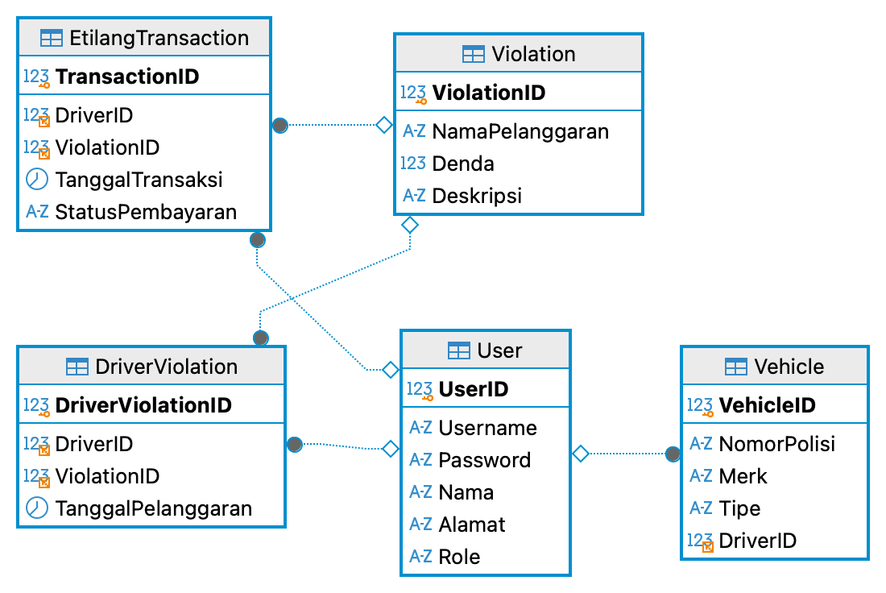
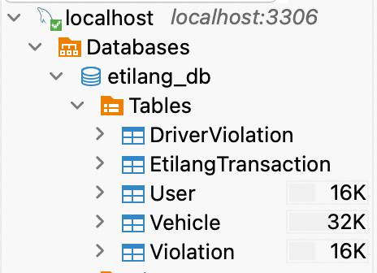

# Sistem Basis Data E-Tilang

Database untuk sistem e-tilang (tilang elektronik) yang dibuat dengan MySQL dan DBeaver.

## Struktur Database

| Tabel | Fungsi |
|---|---|
| User | Data pengguna (admin dan pengemudi) |
| Vehicle | Data kendaraan milik pengemudi |
| Violation | Jenis pelanggaran dan besar denda |
| DriverViolation | Catatan pelanggaran per pengemudi |
| EtilangTransaction | Transaksi denda dan status pembayaran |

## Diagram Relasi (ERD)



## Contoh Query

```sql
SELECT u.Nama, v.NamaPelanggaran AS Pelanggaran, v.Denda, t.StatusPembayaran AS Status
FROM EtilangTransaction t
JOIN User u ON t.DriverID = u.UserID
JOIN Violation v ON t.ViolationID = v.ViolationID;
```

Hasil:



## Cara Menjalankan

1. Install MySQL dan DBeaver.
2. Buat database kosong: `CREATE DATABASE etilang_db;`
3. Import file `e-tilang-bersih.sql` ke database tersebut.

## Tools

MySQL, DBeaver, SQL
